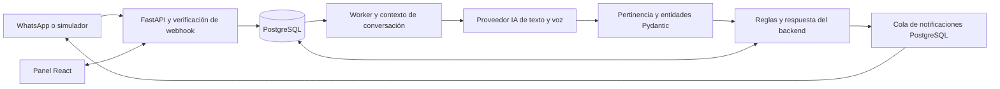

# EcoConecta Chatbot

> Prototipo aislado para desarrollo y evaluación con datos sintéticos. Arranca con su propio volumen Docker de demo. Usa estas migraciones únicamente en una base de pruebas vacía. La integración con el backend y la PostgreSQL unificada se coordinará por separado.

Asistente comunitario de Villas de San Pablo. Recibe avisos de residuos, orienta sobre separación y compostaje y consulta actividades publicadas. El servicio funciona independientemente del clasificador visual. Un adaptador futuro puede implementar el contrato de `app/vision_contract.py` para aportar sugerencias que el usuario pueda verificar.

## Demo local

Desde este directorio:

```sh
cp .env.example .env
```

Define `POSTGRES_PASSWORD` en `.env` con un valor aleatorio alfanumérico. Deja `APP_ENV=demo`, `AI_PROVIDER=mock` y `WHATSAPP_PROVIDER=mock`.

```sh
docker compose up -d --build --wait
docker compose exec api python -m app.seed demo
```

Los tokens personales de demostración se muestran una vez al crear los usuarios. Guárdalos localmente. Abre [el panel](http://localhost:8091/panel) para conversar con `tienda-demo` o `hogar-demo`. Entra como `coord-huerta` o `coord-reciclaje` para gestionar su bandeja, y como el recolector asignado para confirmar la recolección. `admin-demo` puede publicar actividades y revisar artículos. El botón Salir borra el token de la sesión del panel.

- Orgánicos. Envía «Tengo tres bolsas de cáscaras en mi negocio, manzana 3, sin preferencia» y luego «Sí». En la bandeja de huerteros, asigna un huertero y registra fecha y hora. Consulta «¿Cómo va mi solicitud?» y cierra la entrega como huertero.
- Reciclaje. Desde la segunda cuenta, envía «Tengo cartón», indica la dirección o referencia y confirma. Si tienes una preferencia, puedes indicarla junto con la dirección. El aviso aparece en la bandeja de recicladores aunque desconozcas el peso.
- Varios materiales. Envía «Tengo dos bolsas de papel, una caja de botellas y un balde de cáscaras en manzana 4 casa 3». Una confirmación genera un aviso por colectivo, con los materiales de ese flujo incluidos.
- Voz. Escribe `ACEPTO AUDIO` y elige **Voz simulada** en el panel. Ingresa una transcripción sintética, revisa el resumen y confirma por escrito.
- Educación y agenda. Prueba «¿Se pueden echar pañales al compost?», «¿Cuándo es el taller de compostaje?» y «¿Quién ganó el Mundial?».
- Puntos. La demo arranca sin tarifas. En una instancia con datos sintéticos se puede publicar una regla con `POST /api/v1/admin/points-rules` usando el token de administrador. Debe coincidir material, unidad y vigencia. Los puntos se calculan a partir de la cantidad verificada en el cierre, sin conversiones de unidades.

Docker publica la API en loopback. `ECO_PORT` permite cambiar el puerto. `docker compose down` detiene la demo y conserva el volumen.

## Arquitectura y controles



1. **Pertinencia.** El backend revisa señales locales y valida los estados `IN_SCOPE`, `OUT_OF_SCOPE` y `UNCERTAIN`. Preguntas ajenas reciben un mensaje de alcance. Los datos ambiguos llevan a una aclaración.
2. **Recuperación.** PostgreSQL busca entre artículos publicados con fuente y revisión editorial registrada. Para consultas abiertas se admiten términos alternativos de la IA. Las entradas iniciales se contrastaron con referencias generales y el contexto entregado. El catálogo de materiales aceptados se valida aparte.
3. **Verificación de salida.** El backend envía texto de un artículo revisado o arma la respuesta con plantillas y datos de PostgreSQL. El proveedor emite JSON de interpretación y transcripción. La IA carece de herramientas de escritura. Confirmaciones escritas, identidad, roles, catálogo y transiciones se verifican en el servidor.

El esquema Alembic incluye identidad y permisos, consentimiento de voz, conversaciones y buzón de mensajes, catálogo, solicitudes, asignaciones, agenda, historial, alertas, auditoría, artículos, notificaciones y puntos. Los mensajes entrantes se deduplican y su contenido se borra al procesarlos. El worker mantiene los avisos de coordinación en la bandeja aunque no pueda enviar una notificación. El cierre y la acreditación se confirman juntos en una transacción. Ante un resultado de envío incierto se requiere revisión operativa antes de reenviar.

## Gemini, alternativa oficial y Meta

| Configuración | Uso |
|---|---|
| `AI_PROVIDER=mock` | Clasificación local y simulación de voz |
| `AI_PROVIDER=gemini` | `GEMINI_API_KEY` y `GEMINI_MODEL`. El valor inicial `gemini-3.6-flash` admite texto, audio y salida estructurada según la ficha de Google |
| `AI_PROVIDER=openai` | `OPENAI_API_KEY`, `OPENAI_MODEL` y `OPENAI_TRANSCRIPTION_MODEL`. Usa el mismo contrato de intención y transcripción |
| `APP_ENV=official` | Para habilitar Gemini se exige `GEMINI_WRITTEN_AUTHORIZATION=confirmed` después de recibir autorización escrita |
| `APP_ENV=pilot` y `WHATSAPP_PROVIDER=meta` | Instancia con datos y credenciales propias del piloto |

El proveedor se especializa mediante instrucciones, ejemplos sintéticos y recuperación de contenido. No se modificaron pesos. Las etapas de voz y NLU externas tienen espera acotada y un intento adicional para fallas transitorias seleccionadas. Ante fallas de texto se usa el clasificador local. Ante voz incierta se pide repetir por escrito.

Para conectar Meta en una instancia de piloto:

1. Configura `META_ACCESS_TOKEN`, `META_PHONE_NUMBER_ID`, `META_WABA_ID`, `META_VERIFY_TOKEN`, `META_APP_SECRET` y `META_GRAPH_VERSION`.
2. Expón la API por HTTPS con un proxy propio y registra `/api/v1/integrations/whatsapp/webhook` para verificación y eventos `messages`.
3. Habilita usuarios de piloto autorizados con `python -m app.seed user --handle IDENTIFICADOR --role resident --phone NUMERO`. Guarda solamente dígitos en formato internacional. Configura los coordinadores y recolectores con su rol y `--flow organic` o `--flow recyclable`. Usa `--notification-opt-in` únicamente cuando exista consentimiento para avisos.
4. Fuera de la ventana de atención se requieren plantillas aprobadas. Configura `META_TEMPLATE_ALERT`, `META_TEMPLATE_SCHEDULE` y `META_TEMPLATE_LANGUAGE` para las plantillas que correspondan. El adaptador envía un parámetro de texto en el cuerpo.
5. Publica el catálogo autorizado por coordinación desde `/api/v1/admin/materials`. Revisa el banco inicial antes de cargarlo con `python -m app.seed articles`.

El webhook verifica el cuerpo firmado y la cuenta configurada. El audio Ogg/Opus requiere permiso previo. Se valida host, tipo, tamaño y firma del contenedor, y se mantiene en memoria durante el procesamiento. Para NLU por texto, las direcciones reconocibles, los identificadores de solicitud y las respuestas a un borrador se procesan localmente. La detección de datos personales de texto libre es heurística. Antes del piloto, se requiere aprobar el tratamiento externo de texto y voz, la retención de datos y la gestión de accesos del personal.

Referencias de implementación. [Gemini 3.6 Flash](https://ai.google.dev/gemini-api/docs/models/gemini-3.6-flash), [audio de Gemini](https://ai.google.dev/gemini-api/docs/audio), [medios de Meta](https://developers.facebook.com/documentation/business-messaging/whatsapp/business-phone-numbers/media), [EPA compostaje doméstico](https://www.epa.gov/recycle/composting-home), [EPA reciclaje](https://www.epa.gov/recycle/frequent-questions-recycling).

## Endpoints y archivos

OpenAPI y prueba manual en [Swagger](http://localhost:8091/docs). Salvo el webhook y la salud del servicio, las rutas operativas requieren un token personal Bearer.

| Ruta | Uso |
|---|---|
| `GET /health`, `GET /panel` | Estado y panel |
| `GET /api/v1/me` | Identidad y rol |
| `POST /api/v1/demo/messages` | Conversación de prueba |
| `GET/POST /api/v1/integrations/whatsapp/webhook` | Verificación y recepción Meta |
| `GET /api/v1/requests`, `GET /api/v1/requests/{id}` | Bandeja y detalle con historial |
| `GET /api/v1/alerts`, `GET /api/v1/collectors` | Alertas y recolectores visibles por rol |
| `POST /api/v1/requests/{id}/{assign,schedule,collect}` | Acciones humanas |
| `POST /api/v1/admin/{events,articles,materials,points-rules}` | Publicación y configuración |
| `GET /api/v1/admin/articles` | Revisión del banco |
| `GET /api/v1/admin/metrics` | Eventos, tiempos y uso agregados por origen |

- `app/main.py`, `app/channel.py`, `app/worker.py` contienen la API, Meta y el procesamiento.
- `app/language.py`, `app/providers.py`, `app/knowledge.py` contienen pertinencia, proveedores y recuperación.
- `app/conversation.py`, `app/operations.py`, `migrations/` contienen el flujo, los permisos por solicitud y la persistencia.
- `panel.tsx` y `app/static/` contienen el panel móvil.
- `tests/`, `datasets/` y `reports/` contienen escenarios, evaluación y resultados.

## Pruebas reproducibles

Desde una instalación con Python 3.12 y una conexión PostgreSQL para pruebas:

```sh
python -m venv .venv
. .venv/bin/activate
pip install -r requirements-dev.txt
# Exporta TEST_DATABASE_URL con la conexión PostgreSQL de pruebas.
python -m pytest -q
ruff check app migrations tests datasets
python -m datasets.evaluation --output reports/intenciones-mock.json
```

Las pruebas crean y eliminan un esquema aleatorio propio. La evaluación puede ejecutarse en Compose con `docker compose exec api python -m datasets.evaluation`. `--provider configured` usa el proveedor seleccionado y puede generar solicitudes de pago. El conjunto contiene frases sintéticas distintas de las usadas en el prompt. El informe incluye precisión, recall, F1 por intención, exactitud, latencia del clasificador local y matriz de confusión.

## Alcance verificado

El informe en `reports/VERIFICACION.md` registra las pruebas realizadas. Falta validar la entrega de mensajes, plantillas y audio con una cuenta Meta y claves de IA reales, así como revisar el catálogo comunitario y las reglas de puntos con sus responsables. La latencia y el costo de llamadas de producción quedan por medir con credenciales autorizadas. El panel prototipo usa tokens revocables por operador. Para una instancia pública, queda pendiente integrar el mecanismo de identidad del backend unificado y reforzar los límites de tráfico y la operación de la cola.

## Continuar una conversación

Puedes preguntar por un material mientras preparas un aviso, corregir un dato o escribir «¿En qué íbamos?» para retomar. Una respuesta a una pregunta ambiental o de dirección deja el aviso pendiente. La creación requiere responder a la confirmación de envío. Si el puerto habitual está ocupado, inicia la demo con `ECO_PORT=8092 docker compose up -d --build --wait` y abre [el panel alternativo](http://localhost:8092/panel).

## Evaluación de la conversación

La [comparación](reports/COMPARACION_ANTES_DESPUES.md) documenta la evaluación local antes y después. Las [métricas conversacionales](reports/METRICAS_CONVERSACIONALES.md) describen la batería de UX y cómo reproducirla.

El [informe de diálogo contextual](reports/DIALOGO_CONTEXTUAL.md) conserva los guiones, las comprobaciones de confirmación y los resultados antes y después.
